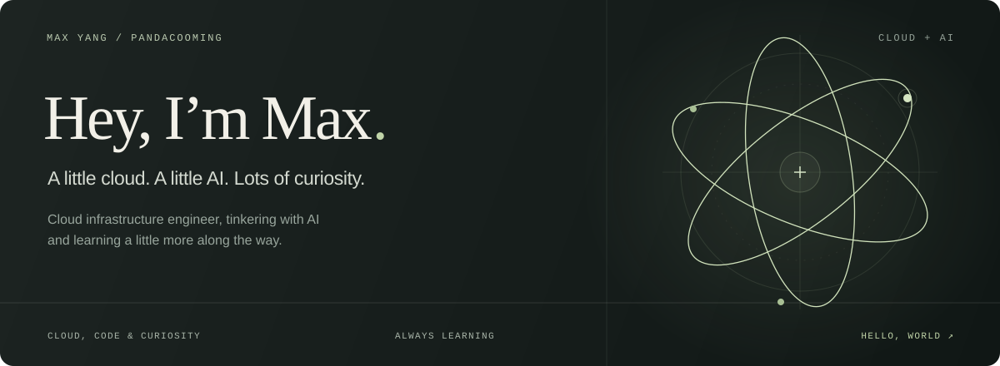

  

### Hey, I'm Max 👋

Cloud infrastructure engineer, AI enthusiast, and always curious about how things work. Here you'll find a few projects I'm exploring and learning from.

### Things I'm into

- ☁️ **Cloud infrastructure** — keeping things running and understanding what happens under the hood.
- 🤖 **AI agents** — trying out frameworks, tools, and ideas.
- 🌱 **Open source** — reading code, following interesting projects, and learning along the way.

### Currently exploring

A few projects I've forked to take a closer look. Credit goes to the upstream teams!

| Project | What caught my eye |
| :--- | :--- |
| **[hermes-agent](https://github.com/pandacooming/hermes-agent)** | AI agents. From [NousResearch/hermes-agent](https://github.com/NousResearch/hermes-agent) |
| **[open-managed-agents](https://github.com/pandacooming/open-managed-agents)** | Managed agent systems. From [rogeriochaves/open-managed-agents](https://github.com/rogeriochaves/open-managed-agents) |
| **[TileKernels](https://github.com/pandacooming/TileKernels)** | The systems underneath AI. From [deepseek-ai/TileKernels](https://github.com/deepseek-ai/TileKernels) |

 

  Thanks for dropping by. Happy exploring! 🌱

