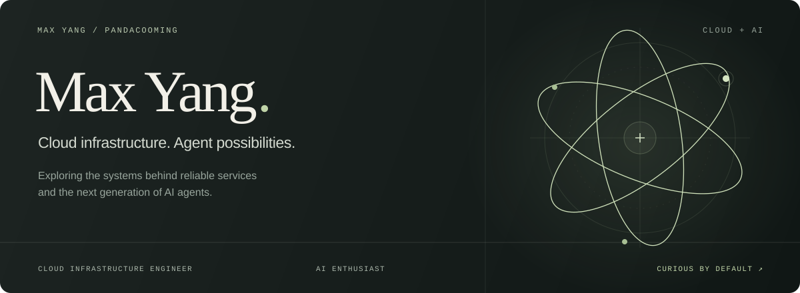

  

  <a href="https://github.com/pandacooming">GitHub</a>
  &nbsp;&nbsp; / &nbsp;&nbsp;
  <a href="https://x.com/max_yangcn">X · @max_yangcn</a>

 

### A little about me

I'm **Max**, a cloud infrastructure engineer interested in how AI agents work—and the infrastructure that helps them run reliably. I explore open-source projects across agents, developer tooling, and AI systems.

 

### What catches my attention

| &nbsp; | Focus | Interests |
| :--- | :--- | :--- |
| **01** | **Cloud infrastructure** | Reliable services and the systems behind them. |
| **02** | **AI agents** | Frameworks, orchestration, and tools for developers. |
| **03** | **Open source** | Learning by exploring how things are built. |

 

### On my radar

A few public forks from projects I'm following. All credit to their upstream teams.

| Project | Why I'm following it |
| :--- | :--- |
| **[hermes-agent](https://github.com/pandacooming/hermes-agent)** | Exploring AI agents. Upstream ↗ [NousResearch/hermes-agent](https://github.com/NousResearch/hermes-agent) |
| **[open-managed-agents](https://github.com/pandacooming/open-managed-agents)** | Exploring managed agent systems. Upstream ↗ [rogeriochaves/open-managed-agents](https://github.com/rogeriochaves/open-managed-agents) |
| **[TileKernels](https://github.com/pandacooming/TileKernels)** | Exploring the systems underneath AI. Upstream ↗ [deepseek-ai/TileKernels](https://github.com/deepseek-ai/TileKernels) |

 

---

  Reliable foundations. Room to explore.

