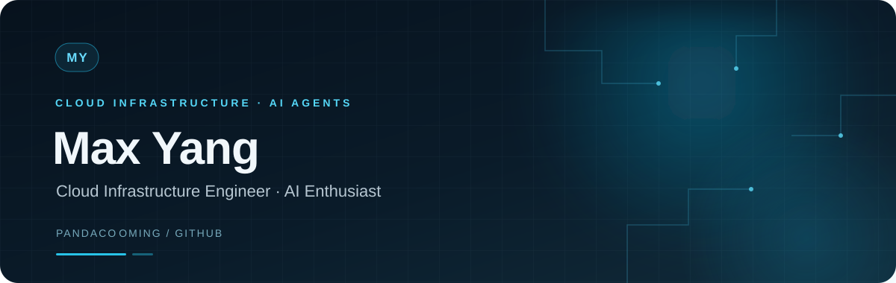

  

<h2 align="center">Hi, I'm Max Yang 👋</h2>

  <strong>Cloud Infrastructure Engineer · AI Enthusiast</strong> 
  Interested in AI agents and the infrastructure that helps intelligent systems run reliably.

  <a href="https://github.com/pandacooming">GitHub</a>
  &nbsp;·&nbsp;
  <a href="https://x.com/max_yangcn">X · @max_yangcn</a>

---

### Areas I follow

- **AI agents** — frameworks, orchestration, and developer tools
- **Cloud infrastructure** — the systems that support reliable services
- **Open source** — learning from projects and sharing useful work

### Selected public forks

These are forks of the upstream projects linked below.

| Repository | Upstream project | Topic |
| --- | --- | --- |
| [hermes-agent](https://github.com/pandacooming/hermes-agent) | [NousResearch/hermes-agent](https://github.com/NousResearch/hermes-agent) | AI agents |
| [open-managed-agents](https://github.com/pandacooming/open-managed-agents) | [rogeriochaves/open-managed-agents](https://github.com/rogeriochaves/open-managed-agents) | Managed agents |
| [TileKernels](https://github.com/pandacooming/TileKernels) | [deepseek-ai/TileKernels](https://github.com/deepseek-ai/TileKernels) | AI systems |

---

  Thanks for stopping by ✨

