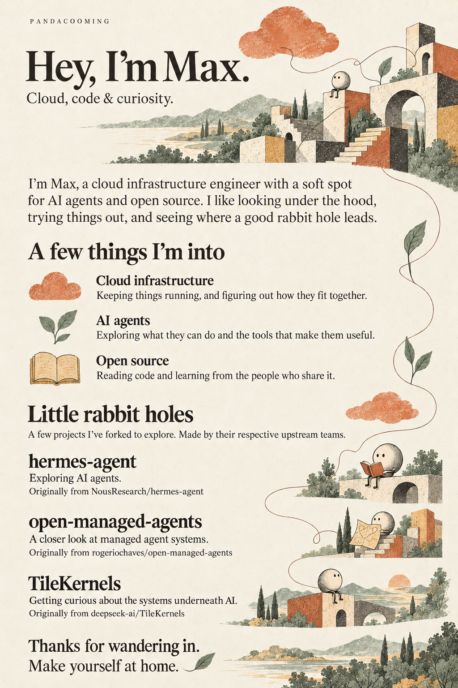

  

Explore the projects ↗

| My fork | Original project |
| :--- | :--- |
| [hermes-agent](https://github.com/pandacooming/hermes-agent) | [NousResearch/hermes-agent](https://github.com/NousResearch/hermes-agent) |
| [open-managed-agents](https://github.com/pandacooming/open-managed-agents) | [rogeriochaves/open-managed-agents](https://github.com/rogeriochaves/open-managed-agents) |
| [TileKernels](https://github.com/pandacooming/TileKernels) | [deepseek-ai/TileKernels](https://github.com/deepseek-ai/TileKernels) |

